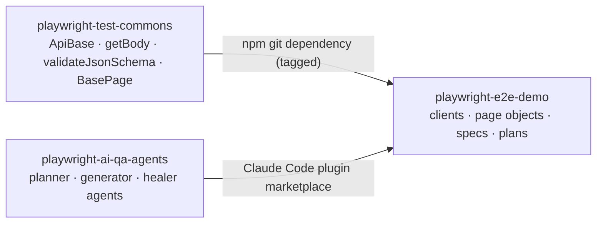

# playwright-test-commons

[](https://github.com/benweese/playwright-test-commons/actions/workflows/ci.yml)

The reusable layer under my Playwright test suites: an API client base class, response helpers, strict JSON schema validation with automatic date checks, and a base page object. It holds no site-specific values, so any test repo can install it and point it at its own site.

It is one of three repos that work together:

| Repo                                                                           | Role                                                                                                         |
| ------------------------------------------------------------------------------ | ------------------------------------------------------------------------------------------------------------ |
| **playwright-test-commons** (this repo)                                        | Shared framework code, versioned with git tags                                                               |
| [playwright-ai-qa-agents](https://github.com/benweese/playwright-ai-qa-agents) | Claude Code plugin whose agents plan, write, run and heal tests                                              |
| [playwright-e2e-demo](https://github.com/benweese/playwright-e2e-demo)         | A real API and UI suite for [automationexercise.com](https://automationexercise.com), built on the other two |



## Install

```bash
npm install -D @playwright/test
npm install github:benweese/playwright-test-commons#v0.1.0
```

`@playwright/test` is a peer dependency, so the test repo picks the Playwright version.

## What's in it

| Export                                                                    | What it does                                                                                                                                       |
| ------------------------------------------------------------------------- | -------------------------------------------------------------------------------------------------------------------------------------------------- |
| `createConfig(environments, { defaultEnv })`                              | Picks the environment from `TEST_ENV`, with `BASE_URL` / `API_BASE_URL` overrides for one-off runs                                                 |
| `ApiBase`                                                                 | Base class for one-client-per-API-area. JSON or form bodies, per-request headers (for tokens set later), one reused request context, debug logging |
| `getBody(response)`                                                       | Asserts 2xx, parses JSON, disposes the response                                                                                                    |
| `errorCheck(response, status, { schema })`                                | Asserts an error status and optionally the error body's shape                                                                                      |
| `timingCheck(call, maxAverageMs)`                                         | Average response time over several calls, ignoring the first                                                                                       |
| `pollUntil(call, condition)`                                              | Waits for eventually-consistent APIs without fixed sleeps                                                                                          |
| `validateJsonSchema(name, body)`                                          | Validates against `schemas/<name>.schema.json` (ajv + formats) and checks every date field                                                         |
| `createJsonSchema` / `UPDATE_SCHEMAS=true`                                | Generates a strict schema from a real response for review                                                                                          |
| `isIsoDate`, `expectValidDate`, `expectDateBetween`, `expectSortedByDate` | Date checks that reject impossible dates like Feb 30                                                                                               |
| `BasePage`                                                                | Page object base: `goto`, `click`, `fill`, `expectVisible`, `expectUrl`, ...                                                                       |
| `generateTestDescription({ id, description, tags })`, `TAGS`              | Test titles like `PROD-003 \| search filters results @ui`, tying each test to its written plan scenario                                            |

## Example

```js
// api/ProductsClient.js in the test repo
import { ApiBase } from "@benweese/playwright-test-commons";
import { config } from "../config/index.js";

class ProductsClient extends ApiBase {
	constructor() {
		super({ baseUrl: config.apiBaseUrl, bodyType: "form" });
	}

	list() {
		return this.get("productsList");
	}

	search(term) {
		return this.post("searchProduct", { search_product: term });
	}
}

export const Products = new ProductsClient();
```

```js
// tests/api/products/products.spec.js
import { test } from "@playwright/test";
import { generateTestDescription, TAGS, getBody, validateJsonSchema } from "@benweese/playwright-test-commons";
import { Products } from "../../../api/ProductsClient.js";

test(generateTestDescription({ id: "PROD-001", description: "lists products", tags: [TAGS.API] }), async () => {
	const body = await getBody(await Products.list());
	await validateJsonSchema("products/productsList", body);
});
```

## Design decisions

- **No work at import time.** Importing the package makes no network or file calls. Config is built by a function the test repo calls, so tools that only import the package never pay for (or fail on) setup.
- **No site values.** URLs and test data live in the consuming repo, which is what lets one framework serve several sites.
- **Curated exports.** A file is public only once `src/index.js` exports it, which keeps the API deliberate.
- **Strict generated schemas.** `additionalProperties: false` on every object, so a new or renamed field fails until someone updates the schema on purpose. Generate once, review, commit.
- **Dates checked for free.** Every schema validation also checks date-like fields (`*At`, `*Date`, `*_at`, ...) and rejects impossible dates.
- **Soft assertions for property checks**, so one run reports every mismatch instead of stopping at the first.

## Development

```bash
npm install
npm run lint
npm test        # unit tests for the framework itself; no browser needed
```

Releases are git tags (`v0.1.0`). Test repos pin a tag and upgrade on purpose.

## License

MIT
