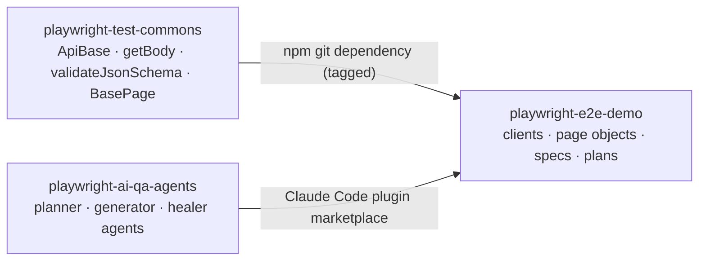

# playwright-test-commons

[](https://github.com/benweese/playwright-test-commons/actions/workflows/ci.yml)

The reusable TypeScript layer under my Playwright test suites: an API client base class, response helpers, strict JSON schema validation with automatic date checks, and a base page object. It holds no site-specific values, so any test repo can install it and point it at its own site.

It is one of three repos that work together:

| Repo                                                                           | Role                                                                                                         |
| ------------------------------------------------------------------------------ | ------------------------------------------------------------------------------------------------------------ |
| **playwright-test-commons** (this repo)                                        | Shared framework code, versioned with git tags                                                               |
| [playwright-ai-qa-agents](https://github.com/benweese/playwright-ai-qa-agents) | Claude Code plugin whose agents plan, write, run and heal tests                                              |
| [playwright-e2e-demo](https://github.com/benweese/playwright-e2e-demo)         | A real API and UI suite for [automationexercise.com](https://automationexercise.com), built on the other two |



## Install

```bash
npm install -D @playwright/test typescript
npm install github:benweese/playwright-test-commons#v0.5.0
```

npm installs from the git tag and runs the package's `prepare` script, which compiles it to `dist/` with type definitions. The test repo gets typed imports without compiling anything itself. `@playwright/test` (1.65 or later) is a peer dependency, so the test repo picks the Playwright version.

npm records GitHub dependencies in the lockfile as `git+ssh`. For CI or machines without a GitHub SSH key, point git at https before `npm ci`:

```bash
git config --global url."https://github.com/".insteadOf ssh://git@github.com/
```

## What's in it

| Export                                                                    | What it does                                                                                                                                                                                                              |
| ------------------------------------------------------------------------- | ------------------------------------------------------------------------------------------------------------------------------------------------------------------------------------------------------------------------- |
| `ApiBase`                                                                 | Base class for one-client-per-API-area. Typed responses (`this.get<ProductList>(...)`), JSON or form bodies, per-request headers (for tokens set later), one reused request context, debug logging                        |
| `getBody(response)`                                                       | Asserts 2xx, parses JSON, disposes the response. Returns the body type the client declared                                                                                                                                |
| `errorCheck(response, status, { schema })`                                | Asserts an error status and optionally the error body's shape                                                                                                                                                             |
| `timingCheck(call, maxAverageMs, { runs, warmup })`                       | Average response time from Playwright's resource timing (`response.timing()`): request sent → last byte, so DNS, TCP and TLS setup never count. Skips a warm-up call, reports time to first byte, and returns the numbers |
| `pollUntil(call, condition)`                                              | Waits for eventually-consistent APIs without fixed sleeps                                                                                                                                                                 |
| `validateJsonSchema(name, body)`                                          | Validates against `schemas/<name>.schema.json` (ajv + formats) and checks every date field                                                                                                                                |
| `createJsonSchema` / `UPDATE_SCHEMAS=true`                                | Generates a strict schema from a real response for review                                                                                                                                                                 |
| `isIsoDate`, `expectValidDate`, `expectDateBetween`, `expectSortedByDate` | Date checks that reject impossible dates like Feb 30                                                                                                                                                                      |
| `BasePage`                                                                | Page object base: `goto`, `click`, `fill`, `expectVisible`, `expectUrl`, ...                                                                                                                                              |
| `generateTestDescription({ id, description, tags })`, `TAGS`              | Test titles like `#0012 \| search filters results @ui`. The id is a number, unique across the repo, that ties each test to its written plan scenario. Tags, not ids, say what kind of test it is                          |
| `formatTestId(id)`                                                        | `12` → `#0012`, for plans and `--grep`                                                                                                                                                                                    |
| Types                                                                     | `ApiBaseOptions`, `FetchOptions`, `LocatorFactory`, `ExpectOptions`, `Tag`, `TestDescription`, `DateOptions`, ... so test repos type their clients and page objects                                                       |

## Example

Name the response body's type once, in the client method. Playwright 1.65+ types `APIResponse<T>`, so `getBody`, `pollUntil` and `response.json()` all return it without repeating the type in the spec.

```ts
// api/ProductsClient.ts in the test repo
import { ApiBase } from "@benweese/playwright-test-commons";

export interface Product {
	id: number;
	name: string;
	price: string;
}

class ProductsClient extends ApiBase {
	constructor() {
		super({ baseUrl: "https://automationexercise.com/api", bodyType: "form" });
	}

	list() {
		return this.get<{ products: Product[] }>("productsList");
	}

	search(term: string) {
		return this.post<{ products: Product[] }>("searchProduct", { search_product: term });
	}
}

export const Products = new ProductsClient();
```

```ts
// tests/api/products/products.spec.ts
import { test } from "@playwright/test";
import { generateTestDescription, TAGS, getBody, validateJsonSchema } from "@benweese/playwright-test-commons";
import { Products } from "../../../api/ProductsClient";

test(generateTestDescription({ id: 1, description: "lists products", tags: [TAGS.API] }), async () => {
	const body = await getBody(await Products.list()); // typed as { products: Product[] }
	await validateJsonSchema("products/productsList", body);
});
```

## Design decisions

- **No work at import time.** Importing the package makes no network or file calls, so tools that only import it never pay for (or fail on) setup.
- **No site values or config.** URLs, settings and test data live in the test repo, which is what lets one framework serve several sites.
- **Curated exports.** A file is public only once `src/index.ts` exports it, which keeps the API deliberate.
- **Strict generated schemas.** `additionalProperties: false` on every object, so a new or renamed field fails until someone updates the schema on purpose. Generate once, review, commit.
- **Dates checked for free.** Every schema validation also checks date-like fields (`*At`, `*Date`, `*_at`, ...) and rejects impossible dates.
- **Soft assertions for property checks**, so one run reports every mismatch instead of stopping at the first.

## Development

```bash
npm install
npm run lint             # ESLint + TypeScript type-check
npx playwright test      # unit tests for the framework itself; no browser needed
npm run build            # compile to dist/
```

TypeScript stays on 6.x until typescript-eslint supports 7. Dependabot keeps everything else current. `package.json` overrides `minimatch` to 11.x to fix [GHSA-g3hv-75wg-m249](https://github.com/advisories/GHSA-g3hv-75wg-m249) in ESLint's dependencies; remove the override once ESLint and typescript-eslint require minimatch 11 themselves.

Releases are git tags (`v0.5.0`). Test repos pin a tag and upgrade on purpose.

## License

MIT
