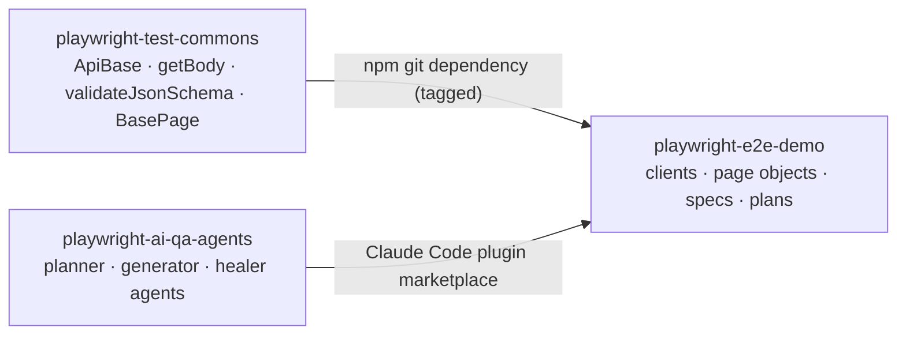

# playwright-test-commons

[](https://github.com/benweese/playwright-test-commons/actions/workflows/ci.yml)

The reusable TypeScript layer under my Playwright test suites: a base class for API clients with typed responses, response and timing helpers, strict JSON schema validation with automatic date checks, and a base page object. It holds no site-specific values, so any test repo can install it and point it at its own site.

## How it fits

It is one of three repos that work together:

| Repo                                                                           | Role                                                                                                         |
| ------------------------------------------------------------------------------ | ------------------------------------------------------------------------------------------------------------ |
| **playwright-test-commons** (this repo)                                        | Shared framework code, versioned with git tags                                                               |
| [playwright-ai-qa-agents](https://github.com/benweese/playwright-ai-qa-agents) | Claude Code plugin whose agents plan, write, run and heal tests                                              |
| [playwright-e2e-demo](https://github.com/benweese/playwright-e2e-demo)         | A real API and UI suite for [automationexercise.com](https://automationexercise.com), built on the other two |



## Requirements

- Node 20 or later (CI uses the version in `.nvmrc`, currently 24)
- `@playwright/test` 1.65 or later in the test repo (a peer dependency, so the test repo picks the version)
- TypeScript in the test repo, to get the typed imports

## Install

```bash
npm install -D @playwright/test typescript
npm install github:benweese/playwright-test-commons#v0.6.0
```

npm installs from the git tag and runs the package's `prepare` script, which compiles it to `dist/` with type definitions, so the test repo gets typed imports without compiling anything itself.

npm records GitHub dependencies in the lockfile as `git+ssh`. For CI or machines without a GitHub SSH key, point git at https before `npm ci`:

```bash
git config --global url."https://github.com/".insteadOf ssh://git@github.com/
```

## Usage

### Set up schemas once

Tell the schema helpers where the test repo keeps its schema files, from the test repo's config:

```ts
// config/index.ts in the test repo
import path from "path";
import { fileURLToPath } from "url";
import { configureSchemas } from "@benweese/playwright-test-commons";

const root = path.resolve(path.dirname(fileURLToPath(import.meta.url)), "..");
configureSchemas({ schemasDir: path.join(root, "schemas") });
```

### Write a client and a test

Name each response body's type once, in the client method. Playwright 1.65+ types `APIResponse<T>`, so `getBody`, `pollUntil` and `response.json()` all return it without the spec repeating it.

```ts
// api/ProductsClient.ts in the test repo
import { ApiBase } from "@benweese/playwright-test-commons";

export interface Product {
	id: number;
	name: string;
	price: string;
}

class ProductsClient extends ApiBase {
	constructor() {
		super({ baseUrl: "https://automationexercise.com/api", bodyType: "form" });
	}

	list() {
		return this.get<{ products: Product[] }>("productsList");
	}

	search(term: string) {
		return this.post<{ products: Product[] }>("searchProduct", { search_product: term });
	}
}

export const Products = new ProductsClient();
```

```ts
// tests/api/products/products.spec.ts in the test repo
import { test } from "@playwright/test";
import {
	generateTestDescription,
	TAGS,
	getBody,
	validateJsonSchema,
	timingCheck
} from "@benweese/playwright-test-commons";
import { Products } from "../../../api/ProductsClient";

test(generateTestDescription({ id: 1, description: "lists products", tags: [TAGS.API] }), async () => {
	const body = await getBody(await Products.list()); // typed as { products: Product[] }
	await validateJsonSchema("products/productsList", body);
});

test(
	generateTestDescription({ id: 2, description: "lists products quickly", tags: [TAGS.API, TAGS.SLOW] }),
	async () => {
		await timingCheck(() => Products.list(), 1000);
	}
);
```

### Write a page object

```ts
// tests/ui/pages/LoginPage.ts in the test repo
import type { Page } from "@playwright/test";
import { BasePage } from "@benweese/playwright-test-commons";
import { loginLocators, type LoginLocators } from "../locators/loginLocators";

export class LoginPage extends BasePage<LoginLocators> {
	constructor(page: Page) {
		super(page, loginLocators);
	}

	async login(email: string, password: string) {
		await this.fill(this.locators.emailInput, email);
		await this.fill(this.locators.passwordInput, password);
		await this.click(this.locators.loginButton);
	}
}
```

### Check test ids

The package installs a `check-test-ids` command. Run it from the test repo, for example as part of lint:

```json
"scripts": {
	"lint": "eslint . && tsc && check-test-ids",
	"check:ids": "check-test-ids"
}
```

It fails, listing each problem, if:

- a test has no id (its title isn't built with `generateTestDescription`)
- an id is used more than once anywhere in the repo (Playwright only catches duplicate titles within one file)
- a test runs in no project, usually because it's missing the tag a project selects on

Otherwise it prints the number of ids and the highest one, which is where the next new test's id starts. It reads `playwright.config.ts` in the current directory; pass another path as the first argument. It lists the tests twice with Playwright, once with the repo's projects and once with every test file, so it needs no setup and works with any project layout.

### Everything it exports

| Export                                                                                                                                                                                                                                    | What it does                                                                                                                                                                                                |
| ----------------------------------------------------------------------------------------------------------------------------------------------------------------------------------------------------------------------------------------- | ----------------------------------------------------------------------------------------------------------------------------------------------------------------------------------------------------------- |
| `ApiBase`                                                                                                                                                                                                                                 | Base class for one-client-per-API-area: typed responses (`this.get<ProductList>(...)`), JSON or form bodies, per-request headers (for tokens set later), one reused request context, optional debug logging |
| `getBody(response)`                                                                                                                                                                                                                       | Asserts 2xx, parses JSON and disposes the response. Returns the body type the client declared                                                                                                               |
| `errorCheck(response, status, { schema })`                                                                                                                                                                                                | Asserts an error status and optionally the error body's shape                                                                                                                                               |
| `timingCheck(call, maxAverageMs, { runs, warmup })`                                                                                                                                                                                       | Average response time from Playwright's `response.timing()`, request sent → last byte, so connection setup never counts. Skips a warm-up call, reports time to first byte, returns the numbers              |
| `pollUntil(call, condition, { message, intervals, timeout })`                                                                                                                                                                             | Retries a call until its body meets a condition, for eventually-consistent APIs, instead of fixed waits                                                                                                     |
| `configureSchemas({ schemasDir, dateOptions })`                                                                                                                                                                                           | Sets where schema files live and how dates are checked. Call once from the test repo's config                                                                                                               |
| `validateJsonSchema(name, body, { update, checkDates })`                                                                                                                                                                                  | Validates a body against `<schemasDir>/<name>.schema.json` (ajv with formats) and checks every date-like field                                                                                              |
| `createJsonSchema(schemasDir, name, body)`                                                                                                                                                                                                | Writes a strict schema from a real response. Usually used through `{ update: true }` or `UPDATE_SCHEMAS=true`                                                                                               |
| `schemaFilePath(schemasDir, name)`                                                                                                                                                                                                        | The file a schema name maps to; refuses names that escape the schemas folder                                                                                                                                |
| `isIsoDate`, `expectValidDate`, `expectDateBetween`, `expectSortedByDate`                                                                                                                                                                 | Date checks that reject impossible dates like Feb 30, with optional dayjs formats for non-ISO dates                                                                                                         |
| `validateDatesInBody(body, { dateKeys, format })`                                                                                                                                                                                         | Walks a body and checks every date-like field (run automatically by `validateJsonSchema`)                                                                                                                   |
| `BasePage`                                                                                                                                                                                                                                | Page object base: `goto`, `click`, `fill`, `selectOption`, `getText`, `getAllTexts`, `expectVisible`, `expectHidden`, `expectText`, `expectUrl`, `searchParams`                                             |
| `generateTestDescription({ id, description, tags })`, `TAGS`                                                                                                                                                                              | Test titles like `#0012 \| search filters results @ui`. The id is a number, unique across the test repo, that ties each test to its plan scenario. Tags say what kind of test it is                         |
| `formatTestId(id)`                                                                                                                                                                                                                        | `12` → `#0012`, for plans and `--grep`                                                                                                                                                                      |
| `check-test-ids [config]` (command)                                                                                                                                                                                                       | Fails on a missing id, a duplicate id or a test no project runs (see above)                                                                                                                                 |
| Types: `ApiBaseOptions`, `FetchOptions`, `LocatorFactory`, `ExpectOptions`, `Tag`, `TestDescription`, `TimingOptions`, `TimingResult`, `PollOptions`, `SchemaSettings`, `ValidateOptions`, `DateOptions`, `DateCheckOptions`, `DateInput` | For typing clients, page objects and options in the test repo                                                                                                                                               |

Every export has JSDoc, so editors show the full description, parameters and examples on hover.

## Layout

```
src/
  api/ApiBase.ts                  base class for API clients
  helpers/response.ts             getBody, errorCheck, timingCheck
  helpers/polling.ts              pollUntil
  helpers/testDescription.ts      generateTestDescription, formatTestId, TAGS
  validation/validateJsonSchema.ts  configureSchemas, validateJsonSchema
  validation/createJsonSchema.ts  createJsonSchema, schemaFilePath
  validation/validateDates.ts     date checks
  ui/BasePage.ts                  base class for page objects
  tools/checkTestIds.ts           the id rules behind check-test-ids
  bin/check-test-ids.ts           the check-test-ids command
  index.ts                        the public API: only what is exported here is public
test/                             unit tests (run by Playwright, no browser) and typing.check.ts (compile-time checks)
dist/                             build output (git-ignored; built on install by the prepare script)
```

## Design decisions

- **No work at import time.** Importing the package makes no network or file calls, so tools that only import it never pay for (or fail on) setup.
- **No site values or config.** URLs, settings and test data live in the test repo, which is what lets one framework serve several sites.
- **Curated exports.** A file is public only once `src/index.ts` exports it, which keeps the API deliberate.
- **Types flow from the client.** A response type is named once, in the client method, and Playwright's `APIResponse<T>` carries it to every helper. Specs never repeat it.
- **Strict generated schemas.** `additionalProperties: false` on every object, so a new or renamed field fails until someone updates the schema on purpose. Generate once, review, commit.
- **Dates checked for free.** Every schema validation also checks date-like fields (`*At`, `*Date`, `*_at`, ...) and rejects impossible dates.
- **Soft assertions for property checks**, so one run reports every mismatch instead of stopping at the first. Pass `{ soft: false }` where later steps depend on a check.
- **Honest timings.** `timingCheck` uses Playwright's resource timing, so DNS, TCP and TLS setup never count against the API.

## Development

```bash
npm install
npm run lint             # ESLint (including JSDoc rules) + TypeScript type-check
npx playwright test      # unit tests; no browser needed
npm run build            # compile to dist/
npm run format           # Prettier
```

CI (`.github/workflows/ci.yml`) runs lint, the Prettier check, the unit tests and the build on every push and pull request.

**Documentation:** every export needs JSDoc (summary, parameters, return value, errors, and an example where useful). Lint fails on an undocumented export or a `@param` that doesn't match.

**Dependencies:** Dependabot opens weekly update pull requests. Two exceptions are pinned on purpose:

- TypeScript is held at 6.x until typescript-eslint supports 7.
- `package.json` overrides `minimatch` to 11.x to fix [GHSA-g3hv-75wg-m249](https://github.com/advisories/GHSA-g3hv-75wg-m249) in ESLint's dependencies. Remove the override once ESLint and typescript-eslint require minimatch 11 themselves.

**Releasing:** bump `version` in `package.json`, push to `main`, then tag it (`git tag -a v0.6.1 -m v0.6.1 && git push origin v0.6.1`). Test repos pin a tag and upgrade on purpose.

## License

MIT
