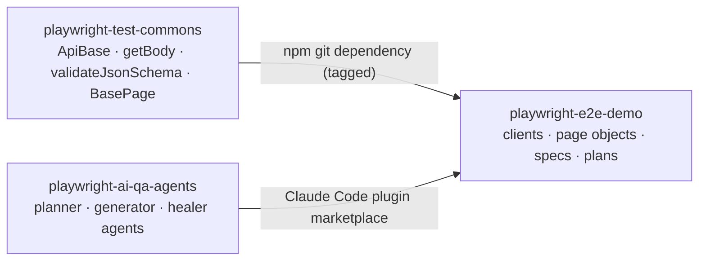

# playwright-test-commons

[](https://github.com/benweese/playwright-test-commons/actions/workflows/ci.yml)
[](https://benweese.github.io/playwright-test-commons/)

The reusable TypeScript layer under my Playwright test suites: a base class for API clients with typed responses, response and timing helpers, strict JSON schema validation with automatic date checks, and a base page object. It holds no site-specific values, so any test repo can install it and point it at its own site.

**[API documentation](https://benweese.github.io/playwright-test-commons/)** (TypeDoc, generated from the JSDoc) · **[Changelog](CHANGELOG.md)**

## How it fits

It is one of three repos that work together:

| Repo                                                                           | Role                                                                                                         |
| ------------------------------------------------------------------------------ | ------------------------------------------------------------------------------------------------------------ |
| **playwright-test-commons** (this repo)                                        | Shared framework code, versioned with git tags                                                               |
| [playwright-ai-qa-agents](https://github.com/benweese/playwright-ai-qa-agents) | Claude Code plugin whose agents plan, write, run and heal tests                                              |
| [playwright-e2e-demo](https://github.com/benweese/playwright-e2e-demo)         | A real API and UI suite for [automationexercise.com](https://automationexercise.com), built on the other two |



## Requirements

- Node 20 or later (CI uses the version in `.nvmrc`, currently 24)
- `@playwright/test` 1.65 or later in the test repo (a peer dependency, so the test repo picks the version)
- TypeScript in the test repo, to get the typed imports
- `@axe-core/playwright` 4.10 or later, only for the accessibility scans (an optional peer dependency)

## Install

```bash
npm install -D @playwright/test typescript
npm install github:benweese/playwright-test-commons#v0.8.0
```

npm installs from the git tag and runs the package's `prepare` script, which compiles it to `dist/` with type definitions, so the test repo gets typed imports without compiling anything itself.

npm records GitHub dependencies in the lockfile as `git+ssh`. For CI or machines without a GitHub SSH key, point git at https before `npm ci`:

```bash
git config --global url."https://github.com/".insteadOf ssh://git@github.com/
```

## Usage

### Set up schemas once

Tell the schema helpers where the test repo keeps its schema files, from the test repo's config:

```ts
// config/index.ts in the test repo
import path from "path";
import { fileURLToPath } from "url";
import { configureSchemas } from "@benweese/playwright-test-commons";

const root = path.resolve(path.dirname(fileURLToPath(import.meta.url)), "..");
configureSchemas({ schemasDir: path.join(root, "schemas") });
```

### Write a client and a test

Name each response body's type once, in the client method. Playwright 1.65+ types `APIResponse<T>`, so `getBody`, `pollUntil` and `response.json()` all return it without the spec repeating it.

```ts
// api/ProductsClient.ts in the test repo
import { ApiBase } from "@benweese/playwright-test-commons";

export interface Product {
	id: number;
	name: string;
	price: string;
}

class ProductsClient extends ApiBase {
	constructor() {
		super({ baseUrl: "https://automationexercise.com/api", bodyType: "form" });
	}

	list() {
		return this.get<{ products: Product[] }>("productsList");
	}

	search(term: string) {
		return this.post<{ products: Product[] }>("searchProduct", { search_product: term });
	}
}

export const Products = new ProductsClient();
```

```ts
// tests/api/products/products.spec.ts in the test repo
import { test } from "@playwright/test";
import {
	generateTestDescription,
	TAGS,
	getBody,
	validateJsonSchema,
	timingCheck
} from "@benweese/playwright-test-commons";
import { Products } from "../../../api/ProductsClient";

test(generateTestDescription({ id: 1, description: "lists products", tags: [TAGS.API] }), async () => {
	const body = await getBody(await Products.list()); // typed as { products: Product[] }
	await validateJsonSchema("products/productsList", body);
});

test(
	generateTestDescription({ id: 2, description: "lists products quickly", tags: [TAGS.API, TAGS.SLOW] }),
	async () => {
		await timingCheck(() => Products.list(), 1000);
	}
);
```

### Write a page object

```ts
// tests/ui/pages/LoginPage.ts in the test repo
import type { Page } from "@playwright/test";
import { BasePage } from "@benweese/playwright-test-commons";
import { loginLocators, type LoginLocators } from "../locators/loginLocators";

export class LoginPage extends BasePage<LoginLocators> {
	constructor(page: Page) {
		super(page, loginLocators);
	}

	async login(email: string, password: string) {
		await this.fill(this.locators.emailInput, email);
		await this.fill(this.locators.passwordInput, password);
		await this.click(this.locators.loginButton);
	}
}
```

Page objects use the `BasePage` checks rather than raw `expect`: they are soft by default, take a message, and accept `{ soft: false }` when later steps depend on them or a `timeout` for something known to be slow.

```ts
await this.expectValue(this.locators.quantityInput, "1", "quantity");
await this.expectInvalid(this.locators.emailInput, "email field is invalid");
await this.expectVisible(this.locators.addedModal, '"Added!" modal', { soft: false, timeout: 20_000 });
const dialog = await this.clickAndHandleDialog(this.locators.submitButton, "dismiss");
```

### Scan for accessibility and make test data

```ts
import { expectNoA11yViolations, uniqueEmail } from "@benweese/playwright-test-commons";

await home.open();
await expectNoA11yViolations(page); // WCAG 2.0–2.2 A and AA; needs @axe-core/playwright installed

const email = uniqueEmail({ localPart: "playwright", domain: "example.com" });
```

### Expected errors, polling and dates

```ts
import {
	errorCheck,
	pollUntil,
	expectDateBetween,
	expectSortedByDate,
	expectValidDate
} from "@benweese/playwright-test-commons";

await errorCheck(await Posts.getPost("does-not-exist"), 404, { schema: "errors/error" });

const post = await pollUntil(
	() => Posts.getPost(id),
	(body) => body.status === "published",
	{ message: "post to be published", timeout: 15_000 }
);

expectDateBetween(post.publishedAt, dayjs().subtract(7, "day"), dayjs());
expectSortedByDate(list.items, "publishedAt", "desc");
expectValidDate(order.deliveryDate, { format: "DD/MM/YYYY", label: "deliveryDate" });
```

When a check fails, the message says what to fix. A schema mismatch lists every problem, one line each. Here an API answered HTTP 200 with an error body, so `getBody` passed and the strict schema caught it:

```
Error: Response matches schema "item"
+   "body: missing field \"id\"",
+   "body: missing field \"status\"",
+   "body: unexpected field \"responseCode\"",
+   "body: unexpected field \"message\"",
```

Wrong types show the value received: `body[0].price: must be number, got "12.50"`.

### Check test ids

The package installs a `check-test-ids` command. Run it from the test repo, for example as part of lint:

```json
"scripts": {
	"lint": "eslint . && tsc && check-test-ids",
	"check:ids": "check-test-ids"
}
```

It fails, listing each problem, if:

- a test has no id (its title isn't built with `generateTestDescription`)
- an id is used more than once anywhere in the repo (Playwright only catches duplicate titles within one file)
- a test runs in no project, usually because it's missing the tag a project selects on

Otherwise it prints the number of ids and the highest one, which is where the next new test's id starts. It reads `playwright.config.ts` in the current directory; pass another path as the first argument. It lists the tests twice with Playwright, once with the repo's projects and once with every test file, so it needs no setup and works with any project layout.

### Everything it exports

| Export                                                                                                                                                                                                                                                                                                                                               | What it does                                                                                                                                                                                                                                                                                                                                                                                                                                                                                      |
| ---------------------------------------------------------------------------------------------------------------------------------------------------------------------------------------------------------------------------------------------------------------------------------------------------------------------------------------------------- | ------------------------------------------------------------------------------------------------------------------------------------------------------------------------------------------------------------------------------------------------------------------------------------------------------------------------------------------------------------------------------------------------------------------------------------------------------------------------------------------------- |
| `ApiBase`                                                                                                                                                                                                                                                                                                                                            | Base class for one-client-per-API-area: typed responses (`this.get<ProductList>(...)`), JSON or form bodies, per-request headers (for tokens set later), one reused request context, optional debug logging                                                                                                                                                                                                                                                                                       |
| `getBody(response)`                                                                                                                                                                                                                                                                                                                                  | Asserts 2xx, parses JSON and disposes the response. Returns the body type the client declared                                                                                                                                                                                                                                                                                                                                                                                                     |
| `errorCheck(response, status, { schema })`                                                                                                                                                                                                                                                                                                           | Asserts an error status and optionally the error body's shape                                                                                                                                                                                                                                                                                                                                                                                                                                     |
| `timingCheck(call, maxAverageMs, { runs, warmup })`                                                                                                                                                                                                                                                                                                  | Average response time from Playwright's `response.timing()`, request sent → last byte, so connection setup never counts. Skips a warm-up call, reports time to first byte, returns the numbers                                                                                                                                                                                                                                                                                                    |
| `pollUntil(call, condition, { message, intervals, timeout })`                                                                                                                                                                                                                                                                                        | Retries a call until its body meets a condition, for eventually-consistent APIs, instead of fixed waits                                                                                                                                                                                                                                                                                                                                                                                           |
| `configureSchemas({ schemasDir, dateOptions })`                                                                                                                                                                                                                                                                                                      | Sets where schema files live and how dates are checked. Call once from the test repo's config                                                                                                                                                                                                                                                                                                                                                                                                     |
| `validateJsonSchema(name, body, { update, checkDates })`                                                                                                                                                                                                                                                                                             | Validates a body against `<schemasDir>/<name>.schema.json` (ajv with formats) and checks every date-like field                                                                                                                                                                                                                                                                                                                                                                                    |
| `createJsonSchema(schemasDir, name, body)`                                                                                                                                                                                                                                                                                                           | Writes a strict schema from a real response. Usually used through `{ update: true }` or `UPDATE_SCHEMAS=true`                                                                                                                                                                                                                                                                                                                                                                                     |
| `schemaFilePath(schemasDir, name)`                                                                                                                                                                                                                                                                                                                   | The file a schema name maps to; refuses names that escape the schemas folder                                                                                                                                                                                                                                                                                                                                                                                                                      |
| `isIsoDate`, `expectValidDate`, `expectDateBetween`, `expectSortedByDate`                                                                                                                                                                                                                                                                            | Date checks that reject impossible dates like Feb 30, with optional dayjs formats for non-ISO dates                                                                                                                                                                                                                                                                                                                                                                                               |
| `validateDatesInBody(body, { dateKeys, format })`                                                                                                                                                                                                                                                                                                    | Walks a body and checks every date-like field (run automatically by `validateJsonSchema`)                                                                                                                                                                                                                                                                                                                                                                                                         |
| `BasePage`                                                                                                                                                                                                                                                                                                                                           | Page object base. Actions: `goto`, `reload`, `click`, `fill`, `selectOption`, `uploadFiles`, `waitForLoad` (for controls bound late), `clickAndWaitForResponse`, `clickAndHandleDialog`, `recordDialogs`. Reads: `getText`, `getAllTexts`, `searchParams`. Soft checks (pass `{ soft: false }` or a `timeout`): `expectVisible`, `expectHidden`, `expectCount`, `expectAny`, `expectValue`, `expectInvalid` (browser validation), `expectFilesAttached`, `expectText`, `expectUrl`, `expectTitle` |
| `expectNoA11yViolations(page, { tags, exclude })`, `scanA11y`, `WCAG_AA_TAGS`                                                                                                                                                                                                                                                                        | axe-core scan of the page, WCAG 2.0–2.2 A and AA by default; one line per violation in the failure. Needs `@axe-core/playwright` installed (optional peer dependency)                                                                                                                                                                                                                                                                                                                             |
| `uniqueEmail({ domain, localPart })`                                                                                                                                                                                                                                                                                                                 | An address no run has used, `<localPart>+<timestamp>.<random>@<domain>`, on a domain the test repo controls                                                                                                                                                                                                                                                                                                                                                                                       |
| `generateTestDescription({ id, description, tags })`, `TAGS`                                                                                                                                                                                                                                                                                         | Test titles like `#0012 \| search filters results @ui`. The id is a number, unique across the test repo, that ties each test to its plan scenario. Tags say what kind of test it is                                                                                                                                                                                                                                                                                                               |
| `formatTestId(id)`                                                                                                                                                                                                                                                                                                                                   | `12` → `#0012`, for plans and `--grep`                                                                                                                                                                                                                                                                                                                                                                                                                                                            |
| `check-test-ids [config]` (command)                                                                                                                                                                                                                                                                                                                  | Fails on a missing id, a duplicate id or a test no project runs (see above)                                                                                                                                                                                                                                                                                                                                                                                                                       |
| Types: `ApiBaseOptions`, `BodyType`, `Headers`, `FetchOptions`, `LocatorFactory`, `ExpectOptions`, `DialogInfo`, `DialogAction`, `A11yOptions`, `A11yViolation`, `UniqueEmailOptions`, `Tag`, `TestDescription`, `TimingOptions`, `TimingResult`, `PollOptions`, `SchemaSettings`, `ValidateOptions`, `DateOptions`, `DateCheckOptions`, `DateInput` | For typing clients, page objects and options in the test repo                                                                                                                                                                                                                                                                                                                                                                                                                                     |

Every export has JSDoc, so editors show the full description, parameters and examples on hover. The same JSDoc is published as the [API documentation](https://benweese.github.io/playwright-test-commons/).

## Used by

[playwright-e2e-demo](https://github.com/benweese/playwright-e2e-demo), a real API and UI suite for automationexercise.com, uses commons throughout. Links are pinned to commit [`69164e9`](https://github.com/benweese/playwright-e2e-demo/tree/69164e9aa7bba2731a4958c28c9d18f47119703d):

| Utility                                                  | Where it is used                                                                                                                                                                                                                                                                                                     |
| -------------------------------------------------------- | -------------------------------------------------------------------------------------------------------------------------------------------------------------------------------------------------------------------------------------------------------------------------------------------------------------------- |
| `ApiBase`, typed responses                               | [api/ProductsClient.ts](https://github.com/benweese/playwright-e2e-demo/blob/69164e9aa7bba2731a4958c28c9d18f47119703d/api/ProductsClient.ts#L11-L18): a client with `bodyType: "form"` and `this.get<ProductList>(...)`                                                                                              |
| `configureSchemas`                                       | [config/index.ts](https://github.com/benweese/playwright-e2e-demo/blob/69164e9aa7bba2731a4958c28c9d18f47119703d/config/index.ts#L42)                                                                                                                                                                                 |
| `getBody`                                                | [helpers/apiResponse.ts](https://github.com/benweese/playwright-e2e-demo/blob/69164e9aa7bba2731a4958c28c9d18f47119703d/helpers/apiResponse.ts#L27): wrapped for an API that returns HTTP 200 with the real status in the body                                                                                        |
| `validateJsonSchema`                                     | [tests/api/products/products.spec.ts](https://github.com/benweese/playwright-e2e-demo/blob/69164e9aa7bba2731a4958c28c9d18f47119703d/tests/api/products/products.spec.ts#L15)                                                                                                                                         |
| `generateTestDescription`, `TAGS`                        | [tests/smoke/site-up.spec.ts](https://github.com/benweese/playwright-e2e-demo/blob/69164e9aa7bba2731a4958c28c9d18f47119703d/tests/smoke/site-up.spec.ts#L11-L21)                                                                                                                                                     |
| `BasePage`                                               | [tests/ui/pages/LoginPage.ts](https://github.com/benweese/playwright-e2e-demo/blob/69164e9aa7bba2731a4958c28c9d18f47119703d/tests/ui/pages/LoginPage.ts#L6), and every page object in [tests/ui/pages](https://github.com/benweese/playwright-e2e-demo/tree/69164e9aa7bba2731a4958c28c9d18f47119703d/tests/ui/pages) |
| `clickAndHandleDialog`, `recordDialogs`, `expectInvalid` | [tests/ui/pages/ContactPage.ts](https://github.com/benweese/playwright-e2e-demo/blob/69164e9aa7bba2731a4958c28c9d18f47119703d/tests/ui/pages/ContactPage.ts#L110-L138)                                                                                                                                               |
| `expectNoA11yViolations`                                 | [tests/ui/specs/a11y.spec.ts](https://github.com/benweese/playwright-e2e-demo/blob/69164e9aa7bba2731a4958c28c9d18f47119703d/tests/ui/specs/a11y.spec.ts#L23)                                                                                                                                                         |
| `uniqueEmail`                                            | [payloads/accountPayload.ts](https://github.com/benweese/playwright-e2e-demo/blob/69164e9aa7bba2731a4958c28c9d18f47119703d/payloads/accountPayload.ts#L43)                                                                                                                                                           |
| `check-test-ids`                                         | [package.json](https://github.com/benweese/playwright-e2e-demo/blob/69164e9aa7bba2731a4958c28c9d18f47119703d/package.json#L20)                                                                                                                                                                                       |

The demo doesn't use `errorCheck`, `pollUntil`, `timingCheck` or the standalone date checks yet; the unit tests in [test/](test/) show them.

## Layout

```
src/
  api/ApiBase.ts                  base class for API clients
  helpers/response.ts             getBody, errorCheck, timingCheck
  helpers/polling.ts              pollUntil
  helpers/testDescription.ts      generateTestDescription, formatTestId, TAGS
  helpers/email.ts                uniqueEmail
  validation/validateJsonSchema.ts  configureSchemas, validateJsonSchema
  validation/createJsonSchema.ts  createJsonSchema, schemaFilePath
  validation/validateDates.ts     date checks
  ui/BasePage.ts                  base class for page objects
  ui/accessibility.ts             axe-core scans (loads @axe-core/playwright only when a scan runs)
  tools/checkTestIds.ts           the id rules behind check-test-ids
  bin/check-test-ids.ts           the check-test-ids command
  index.ts                        the public API: only what is exported here is public
test/                             unit tests, run by Playwright; typing.check.ts holds compile-time checks
  ui/                             BasePage and accessibility tests (Chromium)
  support/server.ts               local HTTP server the API tests call
  failurePaths.spec.ts            runs fixtures/failing and checks each failure's message
  fixtures/                       suites other tests run on purpose; the normal run skips them
dist/                             build output (git-ignored; built on install by the prepare script)
CHANGELOG.md                      every release; the release workflow takes its notes from here
```

## Design decisions

- **No work at import time.** Importing the package makes no network or file calls, so tools that only import it never pay for (or fail on) setup.
  _Tradeoff:_ setup such as `configureSchemas` is a call the test repo must remember to make; until it does, schemas are read from `<cwd>/schemas`.
- **No site values or config.** URLs, settings and test data live in the test repo, which is what lets one framework serve several sites.
  _Tradeoff:_ each test repo writes its own config and clients, so two repos for the same site repeat that code.
- **Curated exports.** A file is public only once `src/index.ts` exports it, which keeps the API deliberate.
  _Tradeoff:_ a useful internal helper stays out of reach until someone exports it, and every export becomes a promise to keep.
- **Types flow from the client.** A response type is named once, in the client method, and Playwright's `APIResponse<T>` carries it to every helper. Specs never repeat it.
  _Tradeoff:_ the type is a claim, not a check: only `validateJsonSchema` proves the body really has that shape at runtime. It also requires Playwright 1.65+.
- **Strict generated schemas.** `additionalProperties: false` on every object, so a new or renamed field fails until someone updates the schema on purpose. Generate once, review, commit.
  _Tradeoff:_ a harmless new field fails tests too, so schemas need updating whenever the API grows.
- **Dates checked for free.** Every schema validation also checks date-like fields (`*At`, `*Date`, `*_at`, ...) and rejects impossible dates.
  _Tradeoff:_ the check goes by key name, so a date under another name is missed and a non-date under a date-like name is flagged; `dateKeys` and `checkDates: false` cover both.
- **Soft assertions for property checks**, so one run reports every mismatch instead of stopping at the first. Pass `{ soft: false }` where later steps depend on a check.
  _Tradeoff:_ a test keeps running after a failed check, so a later step can fail for a reason that started earlier; read the first error first.
- **Honest timings.** `timingCheck` uses Playwright's resource timing, so DNS, TCP and TLS setup never count against the API.
  _Tradeoff:_ the numbers show server and transfer time, not what a user on a cold connection waits.

## Development

```bash
npm install
npx playwright install chromium   # once; the BasePage and accessibility tests use it
npm run lint                      # ESLint (including JSDoc rules) + TypeScript type-check
npx playwright test               # unit tests
npm run test:coverage             # unit tests with a coverage report (text, and coverage/lcov-report/)
npm run docs                      # API docs to docs-site/ with TypeDoc; fails on any warning
npm run build                     # compile to dist/
npm run format                    # Prettier
```

Developing commons needs Node 22.22.2+ on 22.x, or 24.15+, the range `eslint-plugin-jsdoc` supports. Installing it in a test repo needs only Node 20.

**Tests:** every export has unit tests, including failure paths. A failing soft check fails the test it runs in, so the failing checks live in `test/fixtures/failing` and `failurePaths.spec.ts` runs them in a separate Playwright run, then checks that each one failed with the expected message. Coverage is reported (c8, in the CI job summary), not enforced with a threshold.

**Workflows:**

- `ci.yml`: lint, the Prettier check, unit tests with coverage, and the build, on every push and pull request
- `docs.yml`: builds the TypeDoc site and deploys it to GitHub Pages on every push to `main`. Only the deploy job has `pages: write` and `id-token: write`
- `release.yml`: on a `v*` tag, runs CI, checks the tag matches `package.json`, and creates a GitHub release with that version's section of `CHANGELOG.md`

**Documentation:** every export needs JSDoc (summary, parameters, return value, errors, and an example where useful). Lint fails on an undocumented export or a `@param` that doesn't match.

**Dependencies:** Dependabot opens weekly update pull requests. Two exceptions are pinned on purpose:

- TypeScript is held at 6.x until typescript-eslint supports 7.
- `package.json` overrides `minimatch` to 11.x to fix [GHSA-g3hv-75wg-m249](https://github.com/advisories/GHSA-g3hv-75wg-m249) in ESLint's dependencies. Remove the override once ESLint and typescript-eslint require minimatch 11 themselves.
    - TypeDoc breaks on minimatch 11, so a nested override keeps 10.x for TypeDoc alone, and `npm audit` reports that one. The advisory needs attacker-controlled glob patterns, and TypeDoc only reads the patterns in `typedoc.json`. Drop the nested override once TypeDoc supports minimatch 11.
- `package.json` overrides `glob` to 14.x to fix [GHSA-3g3m-2fjr-6pw4](https://github.com/advisories/GHSA-3g3m-2fjr-6pw4) in c8's dependencies (test-exclude asks for 13.x, and no 13.x release is fixed). Remove it once test-exclude allows glob 14.

**Releasing:**

1. Move the `[Unreleased]` entries in `CHANGELOG.md` under a new `## [x.y.z] - YYYY-MM-DD` heading and update the links at the bottom.
2. Bump `version` in `package.json` and the install tag in this README, then push to `main`.
3. Tag and push: `git tag -a v0.8.0 -m v0.8.0 && git push origin v0.8.0`. The release workflow creates the GitHub release.

Test repos pin a tag and upgrade on purpose.

## License

MIT
